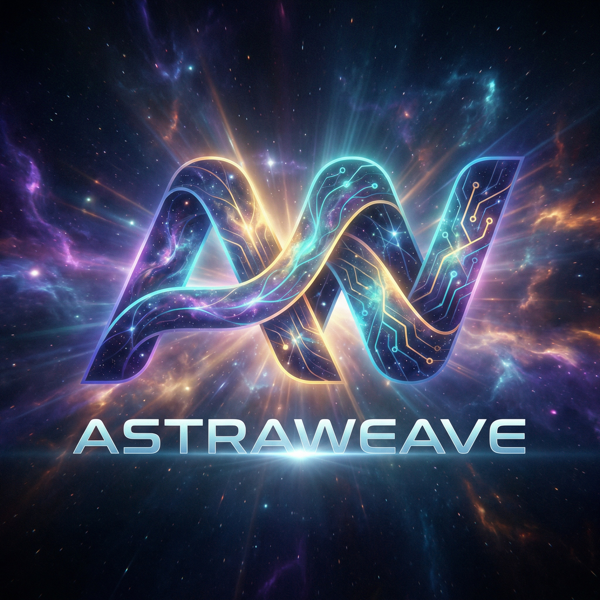

<!-- markdownlint-disable MD013 MD033 MD041 -->

  <section class="astra-hero">
    

      MIT licensed and AI-native
      <h1>Build worlds where intelligent agents are a core system, not an afterthought.</h1>
      

        A free, MIT-licensed Rust game engine where AI agents are a first-class runtime system.
        Deterministic simulation, tool-validated behavior, and Criterion-backed performance &mdash;
        inspectable, reproducible, and open.
      

      

        <a class="astra-button astra-button--primary" href="./architecture/overview.md">Explore the architecture</a>
        <a class="astra-button astra-button--secondary" href="./getting-started/installation.md">Build the workspace</a>
      

      

        MIT license
        Free to use, fork, and modify
        Built for engine developers
      

    

    

      

        

          
        

        

          <strong>Scope</strong>
          Deterministic ECS, AI planning and validation, replay-safe simulation.
          

            Rust 1.89.0, pinned in rust-toolchain.toml
            Replay hashes compared on Linux, Windows, and macOS
            Measured figures live on the engine status page
          

        

      

    

  </section>
  <!--
    Architecture & Methodology section — added 2026-05-15 as part of the
    post-trace-campaign reconciliation. Source: ARCHITECTURE_MAP.md v0.7.0
    §0 Trace Index and §4 Workspace-Wide Structural Axioms.
  -->
  <section class="astra-section" id="methodology" aria-label="Architecture and methodology">
    

      Architecture &amp; methodology
      <h2>Documented through a forensic trace campaign, not aspirational prose.</h2>
    

    

      <article class="astra-card">
        Interactive workspace map
        <h3>Open the workspace map in the browser.</h3>
        

          A Cytoscape.js visualization of the workspace graph, with blast-radius highlighting,
          dependency-path tracing, domain filters, focus mode, and shareable URL state.
          The crate set is the <code>members</code> list in the root <code>Cargo.toml</code>.
          On this tree that list has 140 unique paths
          (<code>astraweave-destruction</code> is entered twice).
          Copy that says 71 production crates is not this tree.
        

        

          <a class="astra-chip" href="https://lazyxeon.github.io/AstraWeave/architecture/">Open the interactive map</a>
        

      </article>
      <article class="astra-card">
        Architecture trace campaign
        <h3>Subsystem traces, version-controlled with the code.</h3>
        

          The generated table in <code>CLAUDE.md</code> lists 31 subsystem traces under
          <code>docs/architecture/</code>. The same count is recorded on the
          <a href="https://github.com/lazyxeon/AstraWeave/blob/main/docs/current/ENGINE_STATUS.md">engine status page</a>.
          The older &ldquo;13 traces&rdquo; figure is the original campaign, not the current set.
          The consolidated synthesis is
          <a href="https://github.com/lazyxeon/AstraWeave/blob/main/docs/architecture/ARCHITECTURE_MAP.md">ARCHITECTURE_MAP.md</a>.
        

      </article>
      <article class="astra-card">
        Honest about what is in flight
        <h3>Wired core and present-but-unwired surface, both visible.</h3>
        

          The architecture map distinguishes the wired simulation core from crates that
          are in the workspace and not on the default sim tick. Memory, RAG, and
          coordination are in that second set. <code>AIArbiter</code> compiles only with
          <code>llm_orchestrator</code>. <code>VectorStore::search</code> is a linear scan.
          Line-count inventories on older pages were not re-counted for this site.
        

      </article>
    

    

      <a class="astra-button astra-button--primary" href="https://lazyxeon.github.io/AstraWeave/architecture/">Open the workspace map</a>
      <a class="astra-button astra-button--secondary" href="https://lazyxeon.github.io/AstraWeave/dashboard/benchmark_dashboard/">Open the benchmark dashboard</a>
    

  </section>
  <section class="astra-proof-strip" aria-label="Where the figures live">
    <article class="astra-proof-tile">
      <strong>140</strong>
      unique paths in the root Cargo.toml members list (one path is repeated)
    </article>
    <article class="astra-proof-tile">
      <strong>31</strong>
      subsystem traces in the CLAUDE.md table
    </article>
    <article class="astra-proof-tile">
      <strong>1.89.0</strong>
      Rust toolchain pinned in rust-toolchain.toml
    </article>
    <article class="astra-proof-tile">
      <strong>Status</strong>
      Agent capacity, Miri, Kani, coverage, and frame time are dated on the engine status page. This page does not restate them.
    </article>
  </section>
  <section class="astra-section" id="paths">
    

      Quick navigation
      <h2>Jump straight to the area you need.</h2>
    

    

      <article class="astra-card">
        Getting started
        <h3>Set up the workspace and run your first system.</h3>
        <ul class="astra-link-list astra-link-list--stacked">
          <li>Quick start<a href="./getting-started/quick-start.md">Open quick start</a></li>
          <li>Installation<a href="./getting-started/installation.md">Install dependencies</a></li>
          <li>First companion<a href="./getting-started/first-companion.md">Build your first AI companion</a></li>
        </ul>
      </article>
      <article class="astra-card">
        Architecture
        <h3>Understand the runtime model.</h3>
        <ul class="astra-link-list astra-link-list--stacked">
          <li>Overview<a href="./architecture/overview.md">Read architecture overview</a></li>
          <li>AI-native design<a href="./architecture/ai-native.md">Inspect AI-native design</a></li>
          <li>Validation<a href="./architecture/tool-validation.md">Study tool validation</a></li>
        </ul>
      </article>
      <article class="astra-card">
        Core systems
        <h3>Explore the engine subsystems.</h3>
        <ul class="astra-link-list astra-link-list--stacked">
          <li>AI system<a href="./core-systems/ai/index.md">Open AI systems</a></li>
          <li>Physics and fluids<a href="./core-systems/physics.md">Inspect simulation systems</a></li>
          <li>Terrain and navigation<a href="./core-systems/navigation.md">Browse world systems</a></li>
        </ul>
      </article>
      <article class="astra-card">
        Examples and performance
        <h3>Demos, benchmarks, and optimization.</h3>
        <ul class="astra-link-list astra-link-list--stacked">
          <li>Examples<a href="./examples/index.md">Browse examples</a></li>
          <li>Benchmarks<a href="./performance/benchmarks.md">Open benchmark dashboard</a></li>
          <li>Optimization<a href="./performance/optimization.md">Read optimization guide</a></li>
        </ul>
      </article>
      <article class="astra-card">
        Engine development
        <h3>Contribute and build from source.</h3>
        <ul class="astra-link-list astra-link-list--stacked">
          <li>Contributing<a href="./dev/contributing.md">Open contribution guide</a></li>
          <li>Building<a href="./dev/building.md">Build from source</a></li>
          <li>Testing<a href="./dev/testing.md">Review validation workflow</a></li>
        </ul>
      </article>
      <article class="astra-card">
        API and reference
        <h3>Subsystem APIs and crate documentation.</h3>
        <ul class="astra-link-list astra-link-list--stacked">
          <li>API overview<a href="./api/index.md">Open API reference</a></li>
          <li>Crate map<a href="./reference/crates.md">Browse crate documentation</a></li>
          <li>CLI and config<a href="./reference/cli-tools.md">Inspect tools and configuration</a></li>
        </ul>
      </article>
    

  </section>
  <section class="astra-section" id="proof">
    

      Why AstraWeave
      <h2>Architecture, safety, and performance you can verify.</h2>
    

    

      <article class="astra-card">
        <svg class="astra-card-icon" viewBox="0 0 32 32" aria-hidden="true"><circle cx="16" cy="10" r="4" fill="none" stroke="currentColor" stroke-width="1.5"/><path d="M8 22c0-4.4 3.6-8 8-8s8 3.6 8 8" fill="none" stroke="currentColor" stroke-width="1.5"/><circle cx="6" cy="14" r="2.5" fill="none" stroke="currentColor" stroke-width="1.2" opacity=".5"/><circle cx="26" cy="14" r="2.5" fill="none" stroke="currentColor" stroke-width="1.2" opacity=".5"/><line x1="8.5" y1="14" x2="13" y2="12" stroke="currentColor" stroke-width="1" opacity=".35"/><line x1="23.5" y1="14" x2="19" y2="12" stroke="currentColor" stroke-width="1" opacity=".35"/></svg>
        AI-first architecture
        <h3>Perception &rarr; reasoning &rarr; planning &rarr; action, built into the runtime.</h3>
        

          World snapshots, plan intents, tool validation, behavior trees, GOAP, and LLM-backed
          planning all plug into a deterministic loop.
        

      </article>
      <article class="astra-card">
        <svg class="astra-card-icon" viewBox="0 0 32 32" aria-hidden="true"><rect x="7" y="7" width="18" height="18" rx="3" fill="none" stroke="currentColor" stroke-width="1.5"/><path d="M13 16l2.5 2.5L19.5 13" fill="none" stroke="currentColor" stroke-width="1.8" stroke-linecap="round" stroke-linejoin="round"/><line x1="16" y1="3" x2="16" y2="7" stroke="currentColor" stroke-width="1.2" opacity=".5"/><line x1="16" y1="25" x2="16" y2="29" stroke="currentColor" stroke-width="1.2" opacity=".5"/><line x1="3" y1="16" x2="7" y2="16" stroke="currentColor" stroke-width="1.2" opacity=".5"/><line x1="25" y1="16" x2="29" y2="16" stroke="currentColor" stroke-width="1.2" opacity=".5"/></svg>
        Deterministic and safe
        <h3>Replay hashes, validator-gated actions, and proof harnesses.</h3>
        

          Required replay cases are compared on Linux, Windows, and macOS.
          Miri and Kani counts are dated measurements on the engine status page.
          This page does not repeat those counts.
        

      </article>
      <article class="astra-card">
        <svg class="astra-card-icon" viewBox="0 0 32 32" aria-hidden="true"><rect x="4" y="18" width="5" height="10" rx="1" fill="currentColor" opacity=".25"/><rect x="11" y="12" width="5" height="16" rx="1" fill="currentColor" opacity=".4"/><rect x="18" y="8" width="5" height="20" rx="1" fill="currentColor" opacity=".55"/><rect x="25" y="4" width="5" height="24" rx="1" fill="currentColor" opacity=".7"/><line x1="4" y1="29" x2="30" y2="29" stroke="currentColor" stroke-width="1" opacity=".3"/></svg>
        Benchmarked subsystems
        <h3>Performance figures stay on the engine status page.</h3>
        

          Frame time, agent capacity, and older Criterion snapshots are recorded with
          their commit and date there. This site does not promote an undated bar chart
          as the latest run.
        

      </article>
    

    

      

        Engine loop
        <h2>Perception &rarr; reasoning &rarr; planning &rarr; validation &rarr; action.</h2>
      

      

        

          <strong>Perception</strong>
          World snapshots from deterministic ECS state.
        

        

          <strong>Reasoning</strong>
          Behavior trees, utility systems, GOAP, or LLM logic.
        

        

          <strong>Planning</strong>
          Action sequences with costs, priorities, and fallbacks.
        

        

          <strong>Validation</strong>
          Cooldowns, LOS, pathing, and sandbox constraints.
        

        

          <strong>Action</strong>
          Approved commands flow into simulation, physics, and rendering.
        

      

    

  </section>
  <section class="astra-section" id="systems">
    

      What ships today
      <h2>A focused stack for intelligent, simulation-heavy games.</h2>
    

    

      <article class="astra-card">
        <svg class="astra-card-icon" viewBox="0 0 32 32" aria-hidden="true"><circle cx="16" cy="16" r="4" fill="currentColor" opacity=".4"/><circle cx="16" cy="16" r="10" fill="none" stroke="currentColor" stroke-width="1.3" stroke-dasharray="3,3"/><circle cx="6" cy="10" r="2" fill="currentColor" opacity=".25"/><circle cx="26" cy="10" r="2" fill="currentColor" opacity=".25"/><circle cx="6" cy="22" r="2" fill="currentColor" opacity=".25"/><circle cx="26" cy="22" r="2" fill="currentColor" opacity=".25"/><line x1="8" y1="10" x2="12" y2="14" stroke="currentColor" stroke-width="1" opacity=".3"/><line x1="24" y1="10" x2="20" y2="14" stroke="currentColor" stroke-width="1" opacity=".3"/><line x1="8" y1="22" x2="12" y2="18" stroke="currentColor" stroke-width="1" opacity=".3"/><line x1="24" y1="22" x2="20" y2="18" stroke="currentColor" stroke-width="1" opacity=".3"/></svg>
        AI orchestration
        <h3>Seven hello_companion modes, feature-gated.</h3>
        

          A default <code>cargo run -p hello_companion</code> uses <code>RuleOrchestrator</code>.
          Behavior Tree, Utility, and Ensemble need <code>llm</code>. LLM and Hybrid need
          <code>ollama</code>. The arbiter flag needs <code>llm_orchestrator</code> and does not
          place <code>AIArbiter</code> on the deterministic tick.
        

        

          <a class="astra-chip" href="./architecture/ai-native.md">AI-native design</a>
          <a class="astra-chip" href="./api/ai.md">AI API</a>
        

      </article>
      <article class="astra-card">
        <svg class="astra-card-icon" viewBox="0 0 32 32" aria-hidden="true"><rect x="4" y="4" width="10" height="10" rx="2" fill="currentColor" opacity=".3"/><rect x="18" y="4" width="10" height="10" rx="2" fill="currentColor" opacity=".2"/><rect x="4" y="18" width="10" height="10" rx="2" fill="currentColor" opacity=".2"/><rect x="18" y="18" width="10" height="10" rx="2" fill="currentColor" opacity=".4"/><line x1="14" y1="9" x2="18" y2="9" stroke="currentColor" stroke-width="1" opacity=".4"/><line x1="9" y1="14" x2="9" y2="18" stroke="currentColor" stroke-width="1" opacity=".4"/><line x1="23" y1="14" x2="23" y2="18" stroke="currentColor" stroke-width="1" opacity=".4"/></svg>
        Deterministic ECS
        <h3>Ordered simulation for replay, tooling, and scale.</h3>
        

          Archetype storage, system staging, iteration guarantees, and event channels
          form a reproducible simulation backbone.
        

        

          <a class="astra-chip" href="./architecture/ecs.md">ECS architecture</a>
          <a class="astra-chip" href="./api/ecs.md">ECS API</a>
        

      </article>
      <article class="astra-card">
        <svg class="astra-card-icon" viewBox="0 0 32 32" aria-hidden="true"><rect x="6" y="8" width="20" height="14" rx="2" fill="none" stroke="currentColor" stroke-width="1.5"/><line x1="6" y1="24" x2="26" y2="24" stroke="currentColor" stroke-width="1.5" stroke-linecap="round"/><circle cx="12" cy="15" r="2" fill="currentColor" opacity=".3"/><circle cx="20" cy="15" r="2" fill="currentColor" opacity=".3"/><line x1="14" y1="15" x2="18" y2="15" stroke="currentColor" stroke-width="1" opacity=".3"/></svg>
        Rendering
        <h3>wgpu-based rendering with real engine workloads.</h3>
        

          PBR materials, clustered lighting, GPU skinning, post-processing, and LOD tooling.
        

        

          <a class="astra-chip" href="./core-systems/rendering.md">Rendering systems</a>
          <a class="astra-chip" href="./api/render.md">Render API</a>
        

      </article>
      <article class="astra-card">
        <svg class="astra-card-icon" viewBox="0 0 32 32" aria-hidden="true"><circle cx="16" cy="16" r="11" fill="none" stroke="currentColor" stroke-width="1.5"/><path d="M16 5v6M16 21v6" stroke="currentColor" stroke-width="1.2" opacity=".4"/><path d="M5 16h6M21 16h6" stroke="currentColor" stroke-width="1.2" opacity=".4"/><path d="M10 22l3-3M19 13l3-3" stroke="currentColor" stroke-width="1.3" stroke-linecap="round"/></svg>
        <!--
          Source: ARCHITECTURE_MAP.md §5.1 Dormant-Code Inventory. Fluids is
          dormant in-design (84.5K LoC, only examples/fluids_demo consumes it,
          no production game-loop crate depends on it). SpatialHash module
          is dormant per physics.md §6 — actual broadphase is Rapier's
          DefaultBroadPhase. Card revised to describe what is actually wired.
        -->
        Physics and movement
        <h3>Rapier-backed dynamics with character controllers and spatial queries.</h3>
        

          Rigid bodies, character controllers, and Rapier collision. <code>PhysicsWorld</code>
          uses Rapier's <code>DefaultBroadPhase</code>. The in-crate <code>SpatialHash</code>
          is not that broadphase. <code>astraweave-fluids</code> is not the game-loop solver.
        

        

          <a class="astra-chip" href="./core-systems/physics.md">Physics</a>
          <a class="astra-chip" href="./core-systems/fluids.md">Fluids (research)</a>
        

      </article>
      <article class="astra-card">
        <svg class="astra-card-icon" viewBox="0 0 32 32" aria-hidden="true"><polygon points="16,4 28,12 28,24 16,28 4,24 4,12" fill="none" stroke="currentColor" stroke-width="1.5"/><line x1="16" y1="4" x2="16" y2="28" stroke="currentColor" stroke-width="1" opacity=".25"/><line x1="4" y1="12" x2="28" y2="12" stroke="currentColor" stroke-width="1" opacity=".25"/><circle cx="16" cy="16" r="2" fill="currentColor" opacity=".4"/></svg>
        Navigation and world systems
        <h3>Navmesh, terrain, scene streaming, and gameplay layers.</h3>
        

          Terrain generation, navigation meshes, crafting, quests, dialogue, and procedural content.
        

        

          <a class="astra-chip" href="./core-systems/navigation.md">Navigation</a>
          <a class="astra-chip" href="./core-systems/terrain.md">Terrain</a>
        

      </article>
      <article class="astra-card">
        <svg class="astra-card-icon" viewBox="0 0 32 32" aria-hidden="true"><path d="M10 8h12a2 2 0 012 2v12a2 2 0 01-2 2H10a2 2 0 01-2-2V10a2 2 0 012-2z" fill="none" stroke="currentColor" stroke-width="1.5"/><path d="M14 14l2 2 4-4" fill="none" stroke="currentColor" stroke-width="1.5" stroke-linecap="round" stroke-linejoin="round"/><line x1="4" y1="12" x2="8" y2="12" stroke="currentColor" stroke-width="1.2" opacity=".4"/><line x1="4" y1="16" x2="8" y2="16" stroke="currentColor" stroke-width="1.2" opacity=".4"/><line x1="4" y1="20" x2="8" y2="20" stroke="currentColor" stroke-width="1.2" opacity=".4"/></svg>
        Tooling and integration
        <h3>Examples, the editor, and a C SDK crate.</h3>
        

          Workspace examples, <code>cargo editor</code> for <code>aw_editor</code>, and
          <code>astraweave-sdk</code>. The editor aliases are <code>editor</code>,
          <code>editor-release</code>, and <code>editor-dev</code>.
        

        

          <a class="astra-chip" href="./examples/index.md">Examples</a>
          <a class="astra-chip" href="./api/index.md">API docs</a>
        

      </article>
    

  </section>
  <section class="astra-section">
    

      <article class="astra-card astra-card--panel">
        Where numbers live
        <h3>Measurements are on the engine status page.</h3>
        

          Agent capacity, validation throughput, CPU frame samples, Miri, Kani, and coverage
          are dated on the
          <a href="https://github.com/lazyxeon/AstraWeave/blob/main/docs/current/ENGINE_STATUS.md">engine status page</a>.
          A February 2026 bar chart that this page used to call the latest run is removed.
          The historical write-up is
          <a href="https://github.com/lazyxeon/AstraWeave/blob/main/docs/masters/MASTER_BENCHMARK_REPORT.md">MASTER_BENCHMARK_REPORT.md</a>.
          It is not a fresh capture.
        

        

          <code>#[kani::proof]</code> appears 69 times in this tree. Engine status records
          that same count as of 2026-06-13 and says it was not a fresh proof run.
          The older &ldquo;71+&rdquo; harness figure is not that count.
        

      </article>
    

    

      <article class="astra-card astra-card--panel">
        Quality posture
        <h3>Verification and testing across the stack.</h3>
        <ul class="astra-list">
          <li>Coverage, Miri, and Kani<strong>Dated on the engine status page</strong></li>
          <li>Kani attributes in this tree<strong>69 <code>#[kani::proof]</code> matches</strong></li>
          <li>Replay compare<strong>Linux, Windows, and macOS</strong></li>
          <li>Desktop CI<strong>Windows, Linux, macOS</strong></li>
        </ul>
      </article>
      <article class="astra-card astra-card--panel">
        Developer routes
        <h3>Pick an entry point.</h3>
        <ul class="astra-link-list">
          <li>System design<a href="./architecture/overview.md">Open architecture overview</a></li>
          <li>Performance data<a href="./performance/benchmarks.md">Open benchmarks</a></li>
          <li>Build and run<a href="./getting-started/quick-start.md">Read quick start</a></li>
          <li>Examples and demos<a href="./examples/index.md">Browse examples</a></li>
          <li>Contributing workflow<a href="./dev/contributing.md">Open contribution guide</a></li>
          <li>Reference implementation<a href="./veilweaver/overview.md">Inspect Veilweaver</a></li>
        </ul>
      </article>
    

  </section>
  <section class="astra-section" id="audiences">
    

      Use cases
      <h2>Where AstraWeave fits best.</h2>
    

    

      <article class="astra-card">
        RPGs and immersive sims
        <h3>Companions, directors, and systemic encounters.</h3>
        

          Projects where NPCs need to observe, plan, and react with more depth than
          state-machine scripting allows.
        

      </article>
      <article class="astra-card">
        Server-authoritative multiplayer
        <h3>Validation and replayability matter.</h3>
        

          Deterministic simulation and tool-gated actions for anti-cheat,
          reproducibility, and replay validation.
        

      </article>
      <article class="astra-card">
        Research and prototyping
        <h3>Benchmarkable AI-native architecture.</h3>
        

          Test agent scale, planning strategies, and hybrid AI control
          under measurable conditions.
        

      </article>
      <article class="astra-card">
        Embedded engine teams
        <h3>Rust core with a C ABI.</h3>
        

          Adopt focused subsystems through the modular crate structure
          instead of committing to the whole stack.
        

      </article>
    

  </section>
  <section class="astra-section" id="lineages">
    

      Design lineages
      <h2>Games this engine could help realize.</h2>
    

    

      <article class="astra-card">
        Colony and world simulation
        <h3>In the lineage of Dwarf Fortress or RimWorld.</h3>
        

          Agent autonomy, world-state memory, logistics, and emergent story generation.
        

      </article>
      <article class="astra-card">
        4X and grand strategy
        <h3>In the lineage of Civilization or Crusader Kings.</h3>
        

          Multi-agent diplomacy, advisor systems, strategic planners, and explainable AI.
        

      </article>
      <article class="astra-card">
        Tactical command games
        <h3>In the lineage of X-COM or Battle Brothers.</h3>
        

          Tool validation, cover awareness, action planning, and replay-safe combat loops.
        

      </article>
      <article class="astra-card">
        Systemic sandboxes
        <h3>In the lineage of Kenshi or Mount and Blade.</h3>
        

          Large numbers of autonomous actors with persistent world consequences.
        

      </article>
      <article class="astra-card">
        Immersive sims and party RPGs
        <h3>In the lineage of Deus Ex or Dragon Age.</h3>
        

          Companion decisions, quest reactivity, systemic encounters, and director-style orchestration.
        

      </article>
      <article class="astra-card">
        Rights-holder remakes
        <h3>Licensed ports or original successors.</h3>
        

          Rebuild ambitious systemic designs with modern AI-native architecture.
        

      </article>
    

  </section>
  <section class="astra-cta">
    

      Next step
      <h2>Clone, build, and decide from evidence.</h2>
      

        AstraWeave is free and MIT licensed. Evaluate, adopt subsystems, or contribute back
        without platform lock-in.
      

    

    

      <a class="astra-button astra-button--primary" href="./getting-started/installation.md">Install dependencies</a>
      <a class="astra-button astra-button--secondary" href="./performance/benchmarks.md">Read benchmark report</a>
      <a class="astra-button astra-button--secondary" href="./dev/contributing.md">Contribute to the engine</a>
    

  </section>

<!-- markdownlint-enable MD013 MD033 MD041 -->
